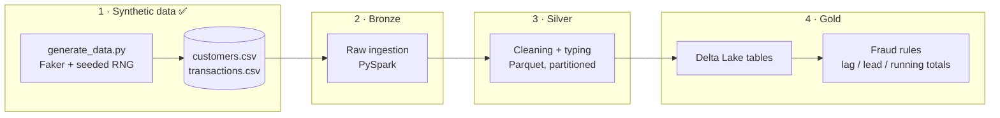

<div align="center">

# 🏦 Banking Lakehouse with PySpark

**A bank-transaction lakehouse built from scratch: reproducible synthetic data, Bronze → Silver → Gold layers, and fraud detection with window functions.**

[](https://github.com/mmartinezvaras/banking-lakehouse-pyspark/actions/workflows/ci.yml)


</div>

---

## At a glance

| | |
|---|---|
| 👥 **Customers** | 1,000 synthetic profiles (Spanish locale) |
| 💳 **Transactions** | 50,062 over 6 months (Jan – Jun 2026) |
| 🚨 **Injected fraud** | 62 transactions in 10 attack bursts — **0.12 %** of the data (≈ 1 in 800) |
| 🌍 **Foreign activity** | 2,563 transactions outside Spain (~5 %) |
| 🔁 **Reproducible** | Fixed seed (`42`) → the exact same dataset on every machine |
| ✅ **Quality gate** | Unit tests run on every push via GitHub Actions |

> All data is synthetic. No real customer data is used.

---

## Why this project

Real fraud is rare, bursty and hidden inside millions of normal payments. That imbalance (about 1 fraudulent transaction per 800) is exactly what makes fraud detection hard, and it is what this dataset reproduces. The goal is to build the full data-engineering path a bank would use: raw files in, clean analytical tables out, and fraud signals computed at scale with Spark.

## Architecture



## How the fraud is simulated

The generator does not sprinkle random "fraud" labels. It models a realistic **compromised-card pattern** (a rapid series of large foreign payments), so detection rules have something meaningful to find:

| Signal | Normal transactions | Injected fraud bursts |
|---|---|---|
| Type | deposit, withdrawal, transfer, card payment | card payment only |
| Amount | Log-normal, median ≈ €33 | Uniform €900 – €3,000 |
| Country | Spain 95 % of the time | Always foreign (FR, DE, US, CN, BR) |
| Timing | Spread across 6 months | 4 – 8 payments, ~1 – 3 min apart |

This is what makes window functions the natural tool for detection: velocity (number of payments in N minutes), sudden jumps in amount (`lag`), and country changes per customer are all computed over a per-customer, time-ordered window.

## Engineering highlights

- **Deterministic generation.** One seeded `random.Random` plus `Faker.seed()`, so tests and analysis are reproducible.
- **Pure, testable functions.** Generation, burst injection and CSV writing are separate functions that take the RNG as a parameter, so they are unit-testable without touching the disk.
- **Scales with input size.** The number of fraud bursts is proportional to the data volume (`n // 5000`, minimum 1).
- **Time-ordered output.** Rows are sorted by timestamp, ready for streaming-style or window-based processing.
- **CI from day one.** Every push and pull request runs `pytest` on GitHub Actions.

## Roadmap

- [x] Project structure, synthetic data generator, tests and CI
- [ ] Ingestion and cleaning with PySpark (Bronze → Silver)
- [ ] Parquet storage with partitioning
- [ ] Delta Lake tables (Gold)
- [ ] Fraud detection with window functions (lag/lead, running totals)
- [ ] Architecture diagram and documentation

## Quick start

```bash
python3.12 -m venv .venv
source .venv/bin/activate
pip install -r requirements.txt
pytest
PYTHONPATH=src python -m banking_lakehouse.generate_data
# -> customers: 1000 | transactions: 50062
```

This writes `data/raw/customers.csv` and `data/raw/transactions.csv`.

## Project structure

```text
banking-lakehouse-pyspark/
├── src/banking_lakehouse/
│   └── generate_data.py      # Synthetic customers + transactions with fraud bursts
├── tests/
│   └── test_generate_data.py # Counts, value ranges, fraud injection
├── data/
│   ├── raw/                  # Generated CSVs (git-ignored)
│   └── processed/            # Parquet / Delta output
├── notebooks/                # Exploration
├── .github/workflows/ci.yml  # pytest on every push
└── requirements.txt
```

## Tech stack

| Layer | Tools |
|---|---|
| Data generation | Python, Faker |
| Processing | PySpark |
| Storage | Parquet, Delta Lake |
| Quality | pytest, GitHub Actions |

---

<div align="center">

Built by **Marcos** · [@mmartinezvaras](https://github.com/mmartinezvaras)

</div>
