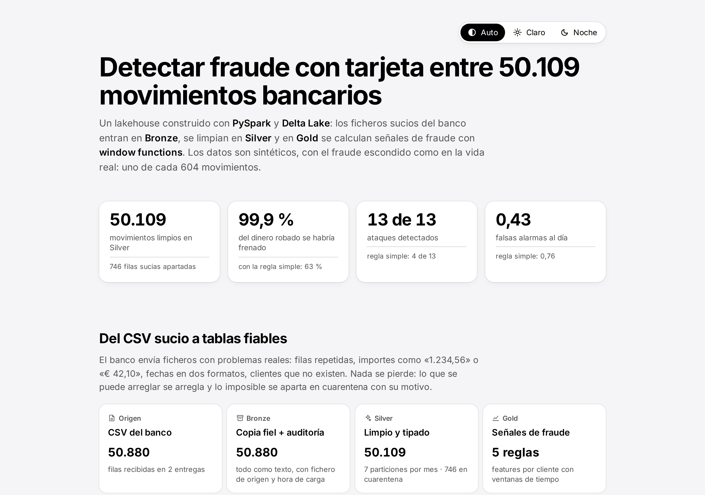
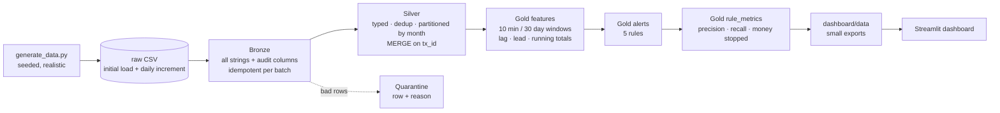
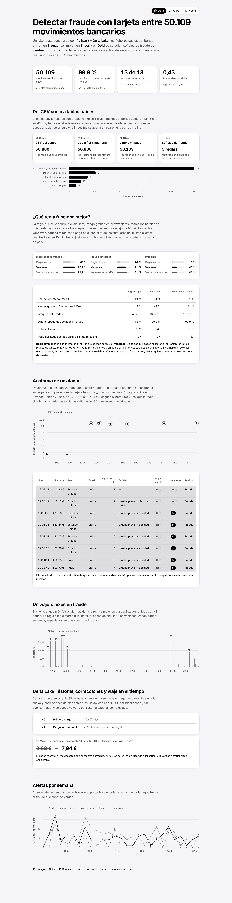
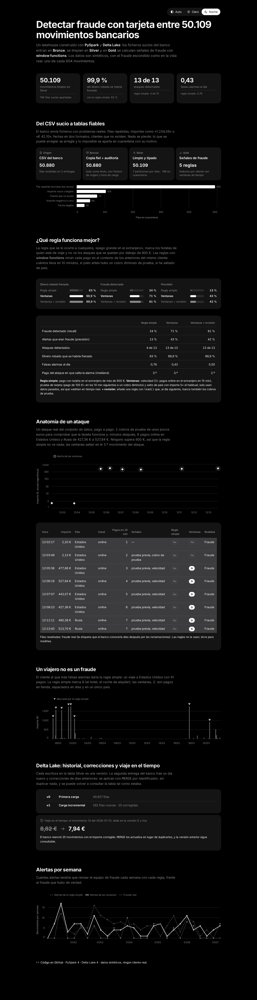

<div align="center">

# 🏦 Banking Lakehouse with PySpark & Delta Lake

**Dirty bank files in, trustworthy tables out, and card fraud caught with window functions.**
Bronze → Silver → Gold on Delta Lake, with MERGE, time travel, a quarantine for bad rows and a measured comparison of fraud rules.

[](https://github.com/mmartinezvaras/banking-lakehouse-pyspark/actions/workflows/ci.yml)


[](https://codespaces.new/mmartinezvaras/banking-lakehouse-pyspark?quickstart=1)



</div>

---

## Results in 30 seconds

Six months of synthetic card activity for 1,000 customers, with fraud hidden as it is in real life: **83 fraudulent payments among 50,109 (1 in 604)**, grouped in 13 attacks.

| | Naive rule<br><sub>card payment abroad > €900</sub> | Window-function rules<br><sub>real time, past data only</sub> |
|---|:---:|:---:|
| Attacks detected | 4 of 13 | **13 of 13** |
| Fraud money that would have been stopped | 63 % | **99.9 %** |
| Fraudulent payments flagged (recall) | 24 % | **71 %** |
| Alerts that were really fraud (precision) | 13 % | **43 %** |
| False alarms per day | 0.76 | **0.43** |

The naive rule flags travellers paying their hotel and misses attacks that stay below €900. The window rules look at each payment in the context of the same customer's previous ones and catch every attack, with fewer false alarms. A next-day review rule using `lead()` raises recall to **81 %** and fires on the 2nd payment of an attack instead of the 3rd.

*These numbers are produced by CI on every push (`dashboard/data/summary.json`), not written by hand.*

## What it shows

- **Medallion architecture on Delta Lake.** Bronze keeps a faithful, all-text copy with audit columns (source file, batch, load time). Silver is typed, deduplicated and partitioned by month. Gold holds features, alerts and metrics.
- **Real-world dirty data, handled explicitly.** European amounts (`1.234,56`, `€ 42,10`), two date formats, inconsistent casing, repeated deliveries, unknown customers. Everything fixable is fixed; the rest goes to a **quarantine table with a reason**, so every raw row is accounted for (tested).
- **Incremental loads with `MERGE`.** The second delivery brings a new day plus 25 corrected amounts for earlier days: `MERGE` on `tx_id` inserts 282 rows and updates 25, without duplicates. Re-running the pipeline is idempotent (already-loaded batches are skipped).
- **Delta time travel and maintenance.** Version 0 is still queryable after the correction (`versionAsOf`), and `OPTIMIZE … ZORDER BY customer_id` compacts the features table.
- **Window functions for fraud.** `rangeBetween` windows over the last 10 minutes and 30 days, `lag` / `lead`, running daily totals, distinct countries in a window.
- **Evaluation, not just rules.** Precision, recall, F1, false alarms per day, attacks detected, money stopped (blocking from the first alert on) and how early the alert fires.
- **Tested Spark code.** Unit tests for parsing, quarantine, MERGE, time travel and every rule on hand-made cases, plus an end-to-end test, all on a real local Spark + Delta in GitHub Actions.

## Architecture



The dashboard reads small deterministic exports, so it needs no Spark and can be hosted for free. CI runs the full pipeline and commits the exports whenever data or logic change.

## Realistic data, on purpose

Random labels would make any rule look good. The generator (`src/banking_lakehouse/generate_data.py`, fixed seed) builds the situations that make fraud detection hard:

| Pattern | Legit or fraud | Why it matters |
|---|---|---|
| Trips abroad (12.5 % of customers travel), with big hotel or car-hire payments | Legit | False alarms for the naive rule |
| Online shopping sprees abroad: several purchases in minutes | Legit | Looks like velocity attacks |
| Card verification: €1 charge, then a real payment | Legit | Looks like card testing |
| Attack: 1–3 probes of €0.50–3, then 3–6 online payments abroad, 30 s to 3 min apart, hopping countries; 35 % of attacks stay below €900 | Fraud | What the rules have to find |
| Dirty rows and 1 % repeated deliveries | — | What Silver has to clean |

## The fraud rules

| Rule | Logic | Window |
|---|---|---|
| Naive | card payment abroad > €900 | none |
| Velocity | ≥ 3 online card payments abroad in 10 min | `count` over `rangeBetween(-600, 0)` |
| Card testing | ≥ €100 abroad within 10 min of a tiny online foreign probe | `max` over `rangeBetween(-600, -1)` |
| Country hop | different foreign country < 1 h after the previous payment and 5× the 30-day average | `lag`, `avg` over 30 days |
| Probe before attack *(review)* | a tiny probe followed within 10 min by ≥ €100 | `lead` (needs the future, so next-day only) |

The real-time combination is velocity OR card testing OR country hop.

## Data quality

| Reason | Rows |
|---|---:|
| Repeated delivery of the same row | 493 |
| Missing or unreadable amount | 104 |
| Unknown customer | 73 |
| Negative or zero amount | 48 |
| Unreadable timestamp | 28 |

50,880 raw rows → **50,109 in Silver + 746 in quarantine** (the remaining 25 are corrections applied in place by `MERGE`).

## Run it

**In the browser:** open in Codespaces (button above). It installs Java 17 and Spark, generates the data, runs the pipeline and opens the dashboard on port 8501.

**Locally** (Python 3.11+ and Java 17):

```bash
pip install -r requirements.txt -e . -r dashboard/requirements.txt
python -m banking_lakehouse.generate_data     # data/raw: customers, initial load, daily increment
python -m banking_lakehouse.pipeline          # Bronze → Silver → Gold, MERGE, OPTIMIZE, exports
streamlit run dashboard/app.py                # dashboard on http://localhost:8501
pytest -v                                     # Spark + Delta tests
```

<details>
<summary>Project layout</summary>

```
src/banking_lakehouse/
  generate_data.py   realistic synthetic data + dirty rows + increment with corrections
  bronze.py          raw ingestion with audit columns, idempotent per batch
  silver.py          parsing, validation, quarantine, dedup, MERGE
  fraud.py           window features, rules and evaluation
  gold.py            features, alerts, daily customer table, rule metrics
  pipeline.py        end-to-end run + Delta OPTIMIZE / ZORDER
  export.py          small deterministic extracts for the dashboard
dashboard/           Streamlit app (light / dark), reads dashboard/data
tests/               unit + end-to-end tests on local Spark
scripts/             dashboard screenshots for CI
```
</details>

## Screenshots

| Light | Dark |
|---|---|
|  |  |

> All data is synthetic. No real customer data is used.
